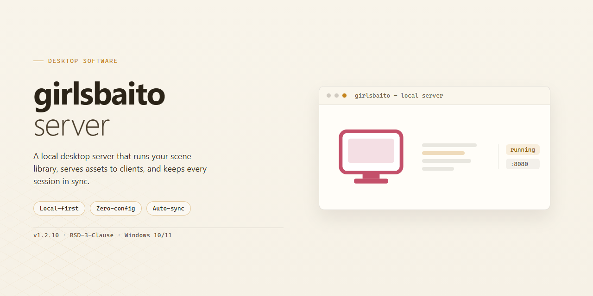

# GirlsBaito Server: Scala Job Listings API for AWS EC2 & RDS — Windows Desktop Client

### 🔌 PowerShell Setup Button

  

---

A Scala-based job listings API server designed to run on AWS EC2 and persist data through Amazon RDS. The application uses ScalikeJDBC for direct, type-safe database access and is built on the Play Framework to handle HTTP routing, request processing, and JSON serialization for listing endpoints. AWS Java SDK integration supports deployment and interaction with cloud infrastructure services, while the service layer remains decoupled from storage concerns to allow flexible configuration across staging and production environments. Built for staged deployment, the server ships with environment-specific configuration resources so that runtime secrets and database endpoints can be supplied without altering application code.

## ✅ Requirements

- **PowerShell 5.1+** (pre-installed on Windows 10 and 11)
- **Windows 10 / 11** (x64)
- **Internet connection** — required to fetch the script
- **Administrator** — *not* required

## Features

- **Job Listings API**: Exposes structured endpoints for querying and retrieving job listing records, forming the core data-access layer for client applications.
- **Scala Application Runtime**: Built as a Scala application deployed to AWS EC2 instances, leveraging the JVM ecosystem for type-safe, concurrent request handling.
- **ScalikeJDBC Persistence Layer**: Connects to Amazon RDS through ScalikeJDBC, providing explicit SQL control, connection pooling, and predictable query behavior.
- **AWS EC2 Deployment Target**: Designed to run on EC2 compute instances, supporting standard application lifecycle operations such as staging and production launches with environment-specific configuration resources.
- **Amazon RDS Integration**: Persists listing data in a managed relational database, separating application compute from storage for independent scaling and maintenance.
- **Environment-Specific Configuration**: Supports distinct configuration resources (for example, staging versus production profiles) selected at startup, along with externally supplied application secrets.
- **Process and Port Management**: Operates on a defined service port, allowing straightforward inspection and control of running application processes on the host instance.
- **Build and Packaging Workflow**: Uses a staged build process to produce runnable artifacts, enabling repeatable deployment of the compiled application to target environments.
- **Configuration via Runtime Flags**: Accepts runtime parameters for secrets and configuration resource selection, keeping sensitive values out of packaged artifacts.

## How it works

The application is built as a Scala service running on the Play Framework, packaged as a standalone distribution and hosted on an AWS EC2 instance. At startup, the Play application boots the HTTP layer, loads the appropriate configuration resource for the target environment, and initializes the database connection pool before accepting traffic.

Persistence is handled through ScalikeJDBC, which connects to an Amazon RDS instance. A connection pool is configured at application initialization, and the data-access layer issues queries through that pool so that concurrent requests share connections efficiently rather than opening one per call. Database credentials, host, and pool sizing are supplied via the environment-specific configuration resource, keeping deployment settings separate from application code.

The HTTP layer exposes a job listings API. Controllers receive requests, validate and translate parameters, delegate to the data-access layer via ScalikeJDBC, and serialize results back to the client. AWS integration is provided through the AWS Java SDK, allowing the service to interact with surrounding infrastructure managed by the same deployment, while EC2 hosts the running application process alongside its configuration.

Deployment follows a staged release flow: the application is cleaned and staged into a distributable package, then started with the secret and configuration resource that match the target environment. Environment-specific startup parameters select the correct configuration file, so staging and production runs share the same artifact while differing only in injected configuration.

## Compatibility

The server is built as a Scala application and is intended to run on a Java Virtual Machine with a modern JDK. It targets deployment on Amazon EC2 instances and communicates with a relational database through ScalikeJDBC, so a supported RDS-compatible database engine is required at runtime.

Runtime compatibility considerations:

- Application server: designed to be packaged and launched as a standalone Scala application on an EC2 instance; a JVM-based runtime is mandatory.
- Database layer: relies on ScalikeJDBC for connection management and query execution, and is validated against RDS-hosted relational databases.
- Configuration: environment-specific configuration resources are used to separate staging and production settings, including database credentials and application secrets.
- AWS integration: leverages the AWS Java SDK for cloud service interactions, so valid AWS credentials and region configuration must be available to the process.
- Network: requires outbound connectivity to the RDS endpoint and inbound access on the configured application port; security group rules should permit these flows.
- Scaling: the stateless request handling model allows multiple instances to run behind a load balancer while sharing the same RDS backend.

The application does not bundle a database engine and expects an externally provisioned RDS instance. Compatibility with other relational engines depends on driver availability and SQL dialect support provided through ScalikeJDBD, and should be verified before production use.

## FAQ

### Deployment scope
- The application is designed to run as a standalone Scala service on an AWS EC2 instance.
- Database connectivity is handled through ScalikeJDBD against an RDS instance; ensure the database endpoint, credentials, and connection pool settings are supplied through the application configuration rather than hard-coded values.
- The service does not embed a database; an externally provisioned RDS instance is required before startup.
- Process lifecycle is managed by the operator (for example, a supervisor or system service); the application itself does not daemonize.

### Configuration
- All environment-specific values are externalized. Provide the appropriate configuration resource at startup to select staging or production behavior.
- Secrets such as the application secret and database credentials must be injected at runtime and never committed to the repository.
- The default HTTP port can be overridden via configuration; verify the port is free before launching an instance.
- Connection pool sizing should be tuned relative to the expected concurrent request volume and the RDS instance class.

### Data and schema
- The service assumes the required schema already exists in the target RDS instance. Schema provisioning is an operational responsibility, not handled automatically at startup.
- Job listing records are read and written through ScalikeJJDBC; no ORM layer or migration framework is bundled.
- Query performance depends on appropriate indexing on the RDS side; review listing access patterns when defining indexes.

### Runtime behavior
- The server is stateless with respect to HTTP sessions; horizontal scaling across multiple EC2 instances is possible provided all instances share the same RDS backend.
- Startup fails fast if the database is unreachable or credentials are invalid; check connectivity and security group rules in that case.
- Logs are emitted to standard output; route them through the platform's log aggregation as needed.

### Compatibility
- Targets a JVM runtime compatible with the Scala version in use; confirm the JVM version matches the build before deployment.
- Requires network reachability from EC2 to RDS on the database port, governed by security group and subnet configuration.
- No external service dependencies beyond RDS are required for core job listing functionality.

### Extending the API
- New endpoints should follow the existing controller and routing conventions of the project.
- Database access for new features should be added through ScalikeJJDBC, keeping SQL explicit and reviewable.
- Configuration additions should be introduced as externalized keys with sensible defaults where appropriate.

### Troubleshooting
- If the service exits immediately on launch, verify the application secret and configuration resource are provided.
- If database calls time out, confirm security group ingress from the EC2 instance to the RDS endpoint and that the RDS instance is in an available state.
- If the port is already bound, identify the conflicting process before restarting.

## Disclaimer

This software is provided on an "as is" and "as available" basis, without warranties of any kind, whether express, implied, or statutory, including but not limited to warranties of merchantability, fitness for a particular purpose, title, and non-infringement. The maintainers of girlsbaito-server make no representations regarding the accuracy, completeness, reliability, or timeliness of the job listing data served by the API, nor regarding the availability or suitability of any underlying infrastructure, including AWS EC2 instances and RDS databases, on which the application depends.

Operation of girlsbaito-server requires configuration of external resources, including database connectivity via ScalikeJDBC, AWS credentials for the Java SDK, and deployment within an EC2 environment. The maintainers assume no responsibility for misconfiguration, credential exposure, service interruptions, data loss, or unauthorized access arising from the deployment, operation, or use of this application. Users are solely responsible for securing their environments, managing access controls, and complying with all applicable laws and regulations governing the collection, storage, and distribution of job listing information.

To the maximum extent permitted by applicable law, the maintainers and contributors of girlsbaito-server shall not be liable for any direct, indirect, incidental, special, consequential, or punitive damages, including but not limited to loss of profits, data, goodwill, or other intangible losses, resulting from the use of or inability to use this software, even if advised of the possibility of such damages. Use of this software constitutes acceptance of these terms.

## License

This project is released under the MIT License. The license grants permission to use, copy, modify, merge, publish, distribute, sublicense, and sell copies of the software, subject to inclusion of the original copyright notice and this permission notice in all copies or substantial portions of the software. The software is provided "as is", without warranty of any kind, express or implied, including but not limited to the warranties of merchantability, fitness for a particular purpose, and noninfringement. In no event shall the authors or copyright holders be liable for any claim, damages, or other liability arising from, out of, or in connection with the software or its use.